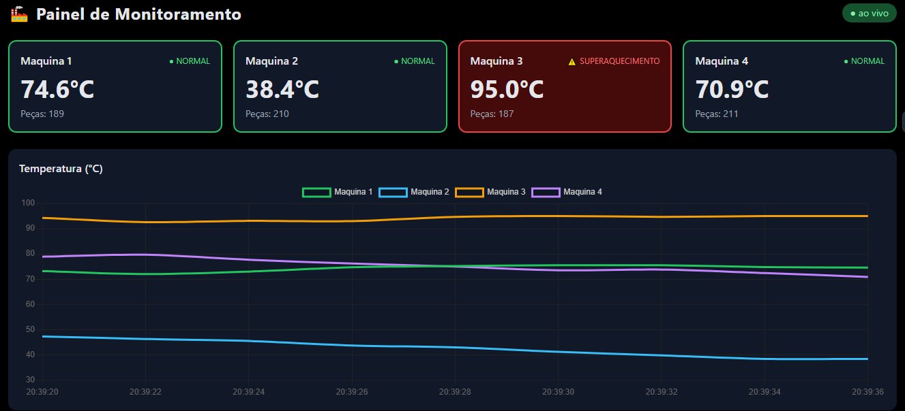

# 🏭 Painel de Monitoramento de Fábrica Inteligente

Simulação de sensores industriais (IoT) com API em **Spring Boot**, painel em tempo real com gráficos e **alertas automáticos de superaquecimento no Telegram**.



## ✨ Funcionalidades

- **Simulador de sensores:** 4 máquinas geram leituras de temperatura e contagem de peças a cada 2 segundos, com variação suave e picos ocasionais de aquecimento.
- **API REST:** recebe e consulta leituras (`POST` e `GET /api/leituras`), com validação dos dados.
- **Painel em tempo real:** tela escura estilo industrial, com um card por máquina (verde = normal, vermelho = superaquecimento) e gráfico de linhas atualizado automaticamente.
- **Alertas no Telegram:** quando a temperatura passa do limite (padrão 80 °C), o bot envia uma mensagem.
- **Cooldown por máquina:** evita spam. Cada máquina só gera um novo alerta após o intervalo configurado (padrão 2 minutos).
- **Design extensível:** os alertas passam pela interface `Notificador`, então outros canais (WhatsApp, e-mail) podem ser adicionados sem mexer na regra de negócio.

## 🏗️ Arquitetura

```
Simulador de sensores
        │
        ▼
   Repositório (JPA) ──► Banco H2 (em memória)
        │
        ├──► LeituraStream (SSE: /api/stream)
        │
        └──► AlertaService ──► Notificador ──► Telegram Bot API
                (limite + cooldown)

Painel (HTML + Tailwind + Chart.js) ──► GET /api/leituras (a cada 2 s)
```

## 🧰 Tecnologias

| Camada | Tecnologia |
|---|---|
| Linguagem | Java 21 |
| Framework | Spring Boot 4.1 (Web, Data JPA, Validation) |
| Banco de dados | H2 (em memória) |
| Front-end | HTML, Tailwind CSS (CDN), Chart.js (CDN), JavaScript |
| Alertas | Telegram Bot API |
| Build | Maven |

## 🚀 Como executar

### Pré-requisitos

- JDK 21
- Maven (opcional, o projeto inclui o `mvnw`)

### Passos

1. Clone o repositório:
   ```bash
   git clone https://github.com/SEU-USUARIO/monitoramento-fabrica.git
   cd monitoramento-fabrica
   ```
2. Execute:
   ```bash
   ./mvnw spring-boot:run
   ```
   No Windows: `mvnw.cmd spring-boot:run`. Também é possível rodar a classe `MonitoramentoApplication` direto pela IDE.
3. Abra **http://localhost:8080/** no navegador.

> O painel carrega Tailwind e Chart.js por CDN, então é necessário ter internet.

## 🔔 Configurando os alertas no Telegram (opcional)

Sem configuração, a aplicação funciona normalmente e os alertas aparecem apenas no log.

1. No Telegram, converse com o **@BotFather**, envie `/newbot` e guarde o **token**.
2. Envie uma mensagem qualquer ao seu bot novo.
3. Descubra o seu **chat id** abrindo `https://api.telegram.org/bot<SEU_TOKEN>/getUpdates` e procurando `"chat":{"id":...`.
4. Defina as variáveis de ambiente antes de iniciar a aplicação:

   ```bash
   # Linux / macOS
   export TELEGRAM_TOKEN=seu_token
   export TELEGRAM_CHAT_ID=seu_chat_id

   # Windows (PowerShell)
   $env:TELEGRAM_TOKEN="seu_token"
   $env:TELEGRAM_CHAT_ID="seu_chat_id"
   ```

> ⚠️ **Nunca** coloque o token no código ou no `application.properties`. Ele é uma senha.

### Parâmetros ajustáveis (`application.properties`)

| Propriedade | Padrão | Descrição |
|---|---|---|
| `alerta.limite` | `80` | Temperatura (°C) acima da qual um alerta é disparado |
| `alerta.cooldown-minutos` | `2` | Intervalo mínimo entre alertas da mesma máquina |

## 📡 Endpoints

| Método | Rota | Descrição |
|---|---|---|
| `POST` | `/api/leituras` | Registra uma leitura |
| `GET` | `/api/leituras` | Retorna as 20 leituras mais recentes |
| `GET` | `/api/stream` | Fluxo de leituras em tempo real (Server-Sent Events) |

Exemplo de corpo para o `POST`:

```json
{
  "maquina": "Maquina 1",
  "temperatura": 47.5,
  "pecas": 120
}
```

## 📁 Estrutura

```
src/main/java/com/fabrica/monitoramento
├── MonitoramentoApplication.java   # ponto de entrada
├── Leitura.java                    # entidade JPA
├── LeituraRequest.java             # DTO com validação
├── LeituraRepository.java          # acesso ao banco
├── LeituraController.java          # rotas REST
├── LeituraStream.java              # distribuição via SSE
├── StreamController.java           # rota /api/stream
├── SimuladorSensores.java          # gerador de leituras
├── AlertaService.java              # regra de limite e cooldown
├── Notificador.java                # interface de notificação
└── TelegramNotificador.java        # implementação para Telegram

src/main/resources/static/index.html   # painel
```

## 🗺️ Próximos passos

- [ ] Persistência com **PostgreSQL via Docker Compose**
- [ ] Limpeza automática de leituras antigas
- [ ] Atualização do painel via SSE/WebSocket, em vez de consulta periódica
- [ ] Notificador para WhatsApp (Twilio ou Cloud API)
- [ ] Histórico por máquina e filtros no painel
- [ ] Testes automatizados

## 📄 Licença

Projeto de estudo e portfólio. Fique à vontade para usar como referência.
